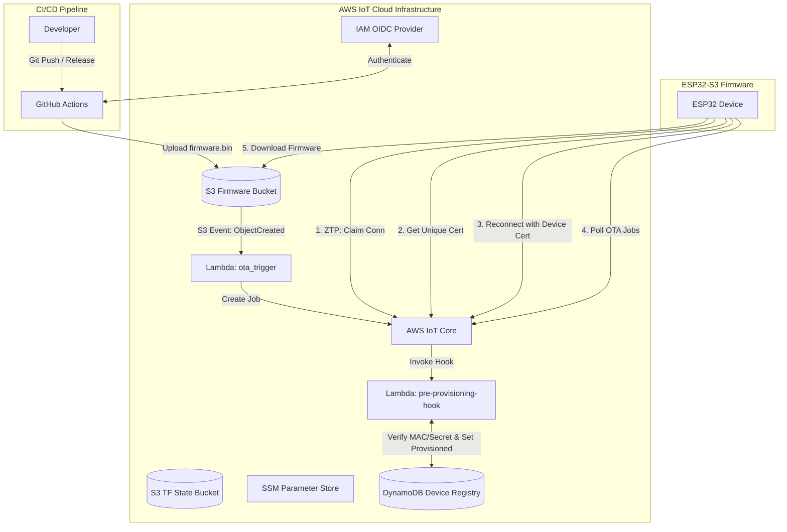
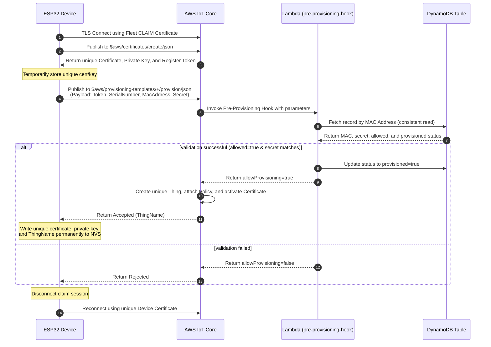
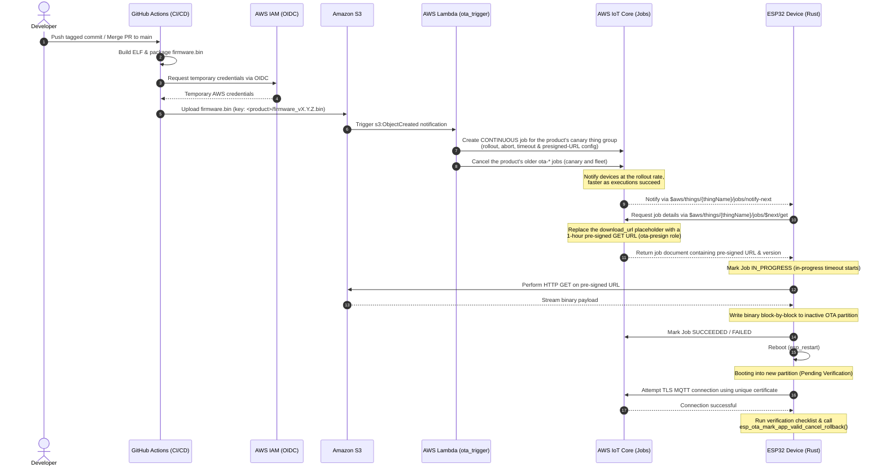

# ESP32 Zero-Touch Provisioning (ZTP) & OTA Platform Infrastructure

This repository contains the Terraform-managed AWS serverless infrastructure that powers **Zero-Touch Fleet Provisioning by Claim (ZTP)** and **Automated, Event-Driven Over-The-Air (OTA) Firmware Updates** for ESP32 devices.

The platform hosts several **products**, listed in the `products` variable ([variables.tf](variables.tf)):

| Product id | Device | Firmware repository | Enrols with |
| :--- | :--- | :--- | :--- |
| `gateway` | OPC UA gateway, Waveshare ESP32-S3-ETH | `ergousha/esp32-opcua-gateway-rust` | the registry secret (key generated by AWS) |
| `vaktus` | Vaktu's-Salât prayer-times display, ESP32 + ATECC608B | `ergousha/esp32-display-vaktus-salat-rust` | its registered public key (key never leaves the ATECC608B) |

Each product has its own fleet and canary thing groups, provisioning template, firmware prefix in the bucket, SSM template parameter and GitHub Actions role. A release of one product can never reach, cancel or overwrite another's.

---

## 1. High-Level Solution Architecture

This diagram shows the relationship between developers, GitHub Actions, AWS infrastructure components, and the ESP32 devices:



---

## 2. Zero-Touch Provisioning (ZTP) Flow

ZTP uses **AWS IoT Fleet Provisioning by Claim**. The device leaves the factory with a **common** "claim" (bootstrap) certificate. Upon first connection, it generates its own **unique** certificate, verifies its identity via a pre-provisioning hook, and receives unique credentials.

### ZTP Sequence Diagram



A device with a secure element (Vaktus) calls `CreateCertificateFromCsr` (`$aws/certificates/create-from-csr/json`) instead of `CreateKeysAndCertificate`: it sends a CSR signed inside its ATECC608B and receives a certificate for that key, so no private key crosses the wire.

### Security Model
*   **Claim certificate is INACTIVE** outside enrolment windows (`var.claim_active = false`). It is extractable from any firmware image or device, so it only works while you enrol a device: `scripts/claim-window.sh [minutes]` activates it and deactivates it again when the time is up or on Ctrl-C (see [Enrolling a Device](#enrolling-a-device)). Provisioned devices use their own certificates and never need it.
*   **Claim Policy**: Allows connecting only as `claim-*` client ids (the firmware uses `claim-<MAC12>`), so a claim holder cannot take over a device's client id. Restricts devices to publish/subscribe *only* on provisioning topics (`$aws/certificates/create/*`, `$aws/certificates/create-from-csr/*` and each product's `$aws/provisioning-templates/<template>/provision/*`). It prevents devices from publishing telemetry or accessing other IoT resources. The claim certificate is shared by all products; what each product may enrol as is decided by the hook.
*   **Device Policy**: Dynamically restricts each provisioned device using policy variables. Devices can only connect if their `ClientId` matches their `ThingName`. They are restricted to publish to `dt/${iot:Connection.Thing.ThingName}/*` and subscribe to `cmd/${iot:Connection.Thing.ThingName}/*`.
*   **Lambda Hook** ([lambda/pre_provisioning_hook](lambda/pre_provisioning_hook/main.go)) fails closed. It rejects the request unless every check passes:
    1. The template is one of the products' templates (from `templateArn`).
    2. The device's MAC (normalised to `AA:BB:CC:DD:EE:FF`, whatever spelling the device sends) is in DynamoDB with `allowed = true`, **not yet `provisioned`**, and, if the record has `enrol_by`, before that time.
    3. The record's `product` is the template's product. A record without `product` was written before products existed and belongs to the legacy product (`gateway`).
    4. **If the record has a `public_key`, or the product sets `require_public_key`** (Vaktus): the certificate being provisioned (`certificatePem`) must carry exactly that key. A leaked claim credential or shared secret is not enough: only the chip holding the registered key can enrol. The secret is not consulted.
    5. **Otherwise** (gateway): the `Secret` parameter must match the record's `secret` (constant-time comparison).
    6. It then marks the record `provisioned` with a conditional write. A record enrols **once**: a second request (a clone using the public gateway secret, or a race) is rejected, and so is a request whose enrolment could not be recorded.

### Device Registry Records

The table is keyed by `mac_address` (`AA:BB:CC:DD:EE:FF`, upper case):

| Attribute | Type | Meaning |
| :--- | :--- | :--- |
| `mac_address` | S | Hash key |
| `product` | S | Product id the device may enrol as. Missing: the legacy product (`gateway`) |
| `allowed` | BOOL | `false` blocks (re-)enrolment |
| `enrol_by` | N | Optional. Unix seconds after which the record no longer enrols |
| `public_key` | S | The device's public key: the 128 hex digits of X‖Y an ATECC608 GenKey returns, the same with a `04` prefix (colons allowed), or a PEM `PUBLIC KEY` block. Required for Vaktus |
| `secret` | S | Shared secret for products without a secure element |
| `provisioned`, `last_provisioned_serial`, `last_certificate_id`, `last_provisioned_via`, `last_provisioned_at` | | Written by the hook on approval. `provisioned = true` blocks any further enrolment |

A Vaktus record:
```sh
aws dynamodb put-item --table-name esp32-ztp-device-registry --item '{
  "mac_address": {"S": "38:18:2B:84:56:F4"},
  "product":     {"S": "vaktus"},
  "allowed":     {"BOOL": true},
  "provisioned": {"BOOL": false},
  "public_key":  {"S": "<128 hex digits the device logs on first boot>"}
}'
```

Write access to this table is effectively the right to enrol a device: keep it to administrators.

### Enrolling a Device

1. Register it: write its record with `provisioned = false` (the `put-item` above, or the gateway repo's `seed-device`).
2. Open a window and power the device: `scripts/claim-window.sh 30`. The device enrols within a couple of minutes; the window closes itself (on time, on Ctrl-C, or when the shell exits). The script is the only thing that closes it: if the laptop dies mid-window, run `aws iot update-certificate --new-status INACTIVE` on the claim, or `terraform apply`. Setting `enrol_by` on the record (Unix seconds, e.g. `$(( $(date +%s) + 3600 ))`) bounds the record's own window server-side.

To **re-enrol** a device (a new key, erased NVS), register it again: writing the record with `provisioned = false` is what allows one more enrolment. Its old certificate stays attached to the thing until you deactivate it.

---

## 3. Firmware Release & OTA Flow

The platform provides automatic, event-driven OTA updates triggered when a new firmware binary is uploaded to Amazon S3. Each upload becomes one AWS IoT Job for **its product's canary thing group**, stopped automatically when a canary fails. Once the canaries succeeded, `scripts/promote.sh <product>` creates the same job for the product's **fleet** group (the canaries are part of it too and settle without a download). The promote step becomes automatic in a later phase of the platform plan.

### Firmware Keys and Routing

| Uploaded key | Product | Job ID |
| :--- | :--- | :--- |
| `<product>/firmware_vX.Y.Z.bin`, e.g. `vaktus/firmware_v0.8.0.bin` | `<product>` | `ota-<product>-firmware_vX-Y-Z-<upload ms>` |
| `firmware_vX.Y.Z.bin` at the bucket root (where releases went before products) | the legacy product, `gateway` | `ota-gateway-…` |
| anything else (an unknown prefix, a deeper path) | none: logged and ignored | — |

Each product's GitHub Actions role may only write under its own prefix (the gateway also at the root, until its release workflow moves to `gateway/`). The job document carries `"product": "<id>"` next to `operation`, `firmware_version` and `download_url`, so firmware can refuse an image meant for another product; older firmware ignores the field.

### OTA Sequence Diagram



The firmware currently reports SUCCEEDED right after the download, before it reboots. [esp32-opcua-gateway-rust#14](https://github.com/ergousha/esp32-opcua-gateway-rust/issues/14) moves that report to the new image, after it has marked itself valid, and reports a rollback as FAILED. From then on, the abort and timeout settings below count real outcomes.

### Thing Groups

| Product | Fleet group (`promote.sh` target) | Canary group (child of fleet; release target) | Provisioning template |
| :--- | :--- | :--- | :--- |
| `gateway` | `esp32-ztp-fleet` | `esp32-ztp-canary` (bench unit `28848553144F`) | `esp32-s3-fleet-template` |
| `vaktus` | `esp32-ztp-vaktus-fleet` | `esp32-ztp-vaktus-canary` (bench unit `38182B8456F4`) | `esp32-ztp-vaktus-fleet-template` |

The gateway keeps the names it had before products existed (pinned in `products.gateway`); new products get `esp32-ztp-<id>-…` names. A product's template puts every device it registers into the product's fleet group and sets the thing attribute `product`. Every release goes to the canary group first; the canary group also receives every promoted fleet job.

AWS IoT allows a thing in only one group of a hierarchy. A device provisioned since its fleet group existed is already in it, so to make it a canary, remove it from the fleet group first, then add it to `products.<id>.canary_things` and apply:
```sh
aws iot update-thing-groups-for-thing --thing-name <thing> --thing-groups-to-remove <fleet group>
```
If a device provisions again, the template leaves its group membership as it is.

### Job Configuration

| Setting | Terraform variable | Default |
| :--- | :--- | :--- |
| Rollout starts at | `ota_rollout_base_rate_per_minute` | 1 device per minute |
| ... and is multiplied by | `ota_rollout_increment_factor` | 2 |
| ... each time this many more devices succeed | `ota_rollout_succeeded_things` | 5 |
| ... up to | `ota_rollout_max_per_minute` | 20 devices per minute |
| Cancel the job when this share of executions ended FAILED, TIMED_OUT or REJECTED | `ota_abort_failure_percentage` | 20 % |
| ... counted once this many devices have been notified | `ota_abort_min_executed_things` | 1 (a single failed canary stops the release) |
| An execution still IN_PROGRESS after this becomes TIMED_OUT | `ota_in_progress_timeout_minutes` | 30 minutes |

Terraform validates these against the ranges the AWS IoT API accepts, and passes them to the Lambda as environment variables. The Lambda checks them again and refuses to start if any is missing or invalid, rather than create a job without its brakes. `aws iot describe-job --job-id <id>` shows the configuration of a created job.

### One Release in Flight

The job is **CONTINUOUS**, so a device that joins the group later still receives it. A continuous job never completes, though, and a device that joined would receive every older release still active, oldest first. So after creating its job, the Lambda cancels the older `ota-*` jobs that target the same product's canary group. Listing a child group's jobs also returns the jobs aimed at its parent; the Lambda reads each job's targets and leaves those fleet jobs alone, so the fleet keeps its last promoted release (for devices that join or come back online) until `promote.sh` replaces it. `promote.sh` cancels the product's older fleet jobs. Other products' groups are never touched. It does not force the cancellation: queued executions are dropped, while a device already mid-update finishes and then takes the new job.

The job ID is `ota-<product>-<version>-<upload time in ms>`, taken from the S3 event rather than the clock. A redelivered or retried event therefore maps to the job it already created, and "older" means an earlier upload even when invocations run out of order. A failed invocation returns an error, so Lambda retries it; the retry finds the job and finishes the cancellation. Uploading the same file again is a new upload: it creates a new job, which the whole group receives again.

### Download URLs

The job document keeps its fields (`operation`, `firmware_version`, `download_url`), but `download_url` holds an AWS IoT placeholder. Each time a device requests the document, AWS IoT replaces it with a pre-signed GET URL valid for an hour, signed as the `esp32-ztp-ota-presign-role`. A device that joins months after the upload, or is reached late in a slow rollout, never gets an expired URL.

---

## 4. Setup & Deployment Guide

### Prerequisites
*   Terraform `>= 1.10` (the S3 backend uses `use_lockfile`; CI pins 1.17.1)
*   AWS CLI `v2`
*   Go `>= 1.22` (required to compile Go Lambda binaries during Terraform runs)

### AWS Authentication Configuration
No long-lived admin credentials exist. The one IAM user's access key lives in the macOS keychain ([aws-vault](https://github.com/99designs/aws-vault)), and on its own it can only read the firmware build parameters in SSM and assume an admin role, which requires MFA:

```ini
# ~/.aws/config
[profile ergin]
region = eu-central-1

[profile ergousha-admin]
source_profile = ergin
role_arn       = arn:aws:iam::<account>:role/owner-admin
mfa_serial     = arn:aws:iam::<account>:mfa/<device>
duration_seconds = 43200
region = eu-central-1
```

```sh
aws-vault add ergin                                     # once: stores the key in the keychain
aws-vault exec ergousha-admin -- terraform apply        # asks for the MFA code, 12-hour session
aws-vault exec ergousha-admin -- scripts/promote.sh vaktus
aws-vault exec ergin -- cargo build --release           # firmware builds only read SSM
```

### Terraform Deployment
1.  Initialize remote backend and providers:
    ```sh
    terraform init
    ```
2.  Inspect proposed changes:
    ```sh
    terraform plan
    ```
3.  Deploy:
    ```sh
    terraform apply
    ```

### Local Development & VS Code Tasks
To simplify developer workflows, this repository is configured with VS Code Tasks (defined in `.vscode/tasks.json`). You can execute them by opening the Command Palette (`Cmd+Shift+P` / `Ctrl+Shift+P`), typing `Tasks: Run Task`, and selecting one of the following:

*   **Go: Build Lambdas**: Compiles both Go Lambda functions for Linux/AMD64.
*   **Go: Run Unit Tests**: Runs all unit tests with verbose logging (`go test -v ./...`).
*   **Go: Format Code**: Formats Go code styling (`gofmt -s -w .`).
*   **Go: Lint Code**: Audits Go code quality using `golangci-lint`.
*   **Go: Clean Binaries**: Cleans up local builds and temporary ZIP archives.
*   **Terraform: Format Files**: Rewrites Terraform files into canonical format (`terraform fmt`).
*   **Terraform: Validate**: Initializes modules and validates Terraform structure (`terraform init -backend=false && terraform validate`).
*   **Terraform: Lint (TFLint)**: Audits Terraform configurations using `tflint`.

### SSM Parameter Store Integration
Terraform automatically publishes the deployment outputs to the AWS Systems Manager (SSM) Parameter Store. You can read them directly using the AWS CLI or build tools, eliminating the need to parse Terraform state files manually:

```sh
# Fetch the AWS IoT ATS Endpoint
aws ssm get-parameter --name "/esp32-ztp/poc/iot_endpoint" --query "Parameter.Value" --output text

# Fetch a product's Provisioning Template Name
aws ssm get-parameter --name "/esp32-ztp/poc/vaktus/provisioning_template_name" --query "Parameter.Value" --output text
# (/esp32-ztp/poc/provisioning_template_name is the gateway's, kept until its build.rs reads /esp32-ztp/poc/gateway/...)

# Fetch the Claim Certificate (SecureString - Decrypted)
aws ssm get-parameter --name "/esp32-ztp/poc/claim_certificate_pem" --with-decryption --query "Parameter.Value" --output text

# Fetch the Claim Private Key (SecureString - Decrypted)
aws ssm get-parameter --name "/esp32-ztp/poc/claim_private_key" --with-decryption --query "Parameter.Value" --output text
```

### Secure GitHub Actions OIDC Trust
This infrastructure uses AWS IAM Identity Federation via OpenID Connect (OIDC) to grant secure access to GitHub Actions runners without requiring long-lived AWS secrets to be saved in GitHub.

Each product has its own role, trusted only by its repository's `main` branch ([iam_github_oidc.tf](iam_github_oidc.tf)). It may upload firmware under its own bucket prefix and read the shared endpoint and claim parameters plus its own template parameter, nothing else:

| Product | Role (the repository's `AWS_ROLE_ARN` variable) | May upload to |
| :--- | :--- | :--- |
| `gateway` | `esp32-ztp-github-actions-role` | `gateway/*`, and `firmware_*` at the root until its release moves |
| `vaktus` | `esp32-ztp-vaktus-github-actions-role` | `vaktus/*` |

`terraform output github_actions_role_arns` lists them. To add a product, add an entry to the `products` variable in [variables.tf](variables.tf) (its repository's numeric id: `gh api repos/<owner>/<repo> --jq .id`) and apply.

---

## 5. Guard Rails (Cost Protection)

Denial-of-wallet is the main threat to a self-funded platform. [guard.tf](guard.tf) wires free CloudWatch alarms and two budgets to the SNS topic `esp32-ztp-guard`. The topic emails `alert_email` (required: set it in `terraform.tfvars`, then click the link in AWS's confirmation mail) and invokes the kill switch ([lambda/kill_switch](lambda/kill_switch/main.go)).

| Alarm / budget | Trips when | Scope |
| :--- | :--- | :--- |
| `esp32-ztp-guard-publish-5m` | IoT publishes (MQTT + HTTPS) > `guard_publish_per_5min` (1,000) in 5 min | traffic |
| `esp32-ztp-guard-publish-30m` | the same for 30 min in a row | fleet |
| `esp32-ztp-guard-connect-5m` | IoT connects > `guard_connect_per_5min` (30) in 5 min | provisioning |
| `esp32-ztp-guard-hook-5m` | hook invocations > `guard_hook_per_5min` (10) in 5 min | provisioning |
| `esp32-ztp-guard-ota-errors`, `-kill-switch-errors` | a Lambda failed | email only |
| budget `esp32-ztp-guard-traffic` | actual cost > $10 this month, again at $15 (email at $5 actual and $10 forecast) | traffic |
| budget `esp32-ztp-guard-fleet` | actual cost > $25 this month, again at $37.50 | fleet |

The measured baseline was at most 48 publishes and 4 connects per 5 minutes. Each scope includes the ones above it:

* **provisioning**: the claim certificate goes INACTIVE.
* **traffic**: the telemetry → CloudWatch Logs rules are disabled.
* **fleet**: the deny-all policy `esp32-ztp-guard-deny-all` is attached to every fleet group. Every device is refused on its next publish or connect, so the fleet goes offline and messaging cost stops.

Every trip is recorded in the SSM parameter `/esp32-ztp/guard/state`. `claim-window.sh` refuses to open a window while it is tripped. Once you know why it tripped:

```sh
aws ssm get-parameter --name /esp32-ztp/guard/state --query Parameter.Value --output text
scripts/guard-reset.sh      # detaches deny-all from the fleet groups, clears the state
terraform apply             # restores the rules to their configured value
```

To cut off a **single** device, add it to the quarantine group, which carries the deny-all policy permanently (Device Defender, which could do this automatically, is no longer offered to new customers):

```sh
aws iot add-thing-to-thing-group --thing-name <thing> --thing-group-name esp32-ztp-quarantine
```

To test the wiring, set the hook alarm by hand (provisioning scope: it only re-asserts the INACTIVE claim). The alarm returns to its real state at the next evaluation, but the kill switch records a **real trip**, so finish with a reset:

```sh
aws cloudwatch set-alarm-state --alarm-name esp32-ztp-guard-hook-5m --state-value ALARM --state-reason test
scripts/guard-reset.sh --yes
```

Do not test with the publish alarms unless you mean it: `publish-30m` cuts off the whole fleet.

Budget notifications lag the spend by hours, so the alarms are the first line and the budgets the backstop. An ACTUAL budget alert fires once per month, so each budget alerts the kill switch again at 150 % (`guard-reset.sh` warns when a budget is already over its limit). The publish alarms count messages, not bytes: AWS bills per 5 KB, so a flood of large messages just under the threshold is bounded only by the budgets. AWS Cost Anomaly Detection (its default services monitor, daily email) is on as well. The Lambda account concurrency limit stays at its default of 10: at most 10 Lambda invocations run at once, whatever triggers them, which caps Lambda cost for free.

---

## 6. Project Costs & Teardown

### Cost Breakdown
All resources deployed in this repository are serverless and billed purely on-demand, costing **~$0.00 USD/month when idle**:

| Service | Billing Model | PoC Cost |
| :--- | :--- | :--- |
| **IoT Core** | per connectivity-minute & message | Negligible for PoC connections |
| **DynamoDB** | PAY_PER_REQUEST (On-Demand), capped at 2 reads and 2 writes per second; PITR on | Billed per request (a few a month); PITR about $0.000001 a month |
| **AWS Lambda** | per invocation & duration | Billed per millisecond; free tier covers PoC |
| **Amazon S3** | per GB-month & requests | Storage cost for binaries is fractions of a cent |
| **CloudWatch Logs** | per GB ingested/stored | Kept low via a 3-day retention period; telemetry routing off by default |
| **CloudWatch alarms, SNS, Budgets** | per alarm metric, message, action | $0: 8 of the 10 free alarm metrics, a handful of messages, budgets without actions |

Telemetry is not routed to CloudWatch Logs by default (`debug_telemetry_logs = false`): every message would be billed as a rule, an action and Logs ingestion. Turn it on for a debugging session or a gateway HIL run (`terraform apply -var debug_telemetry_logs=true`), and off again afterwards.

### Teardown
To destroy all Terraform-managed resources:
```sh
terraform destroy
```
