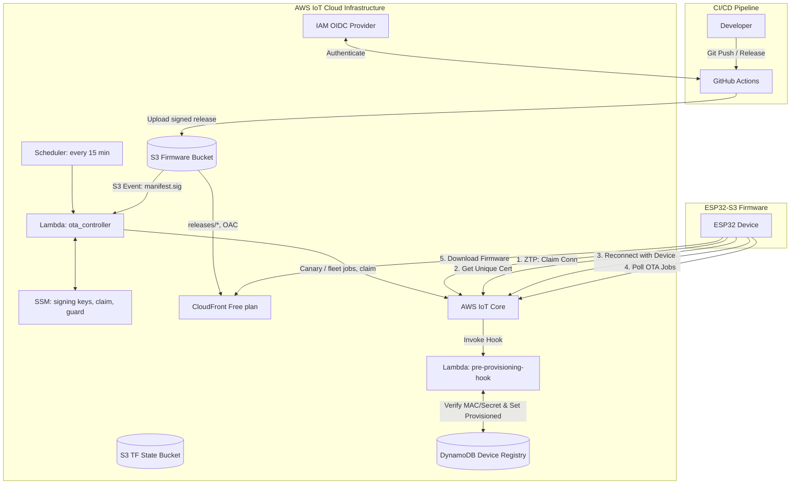
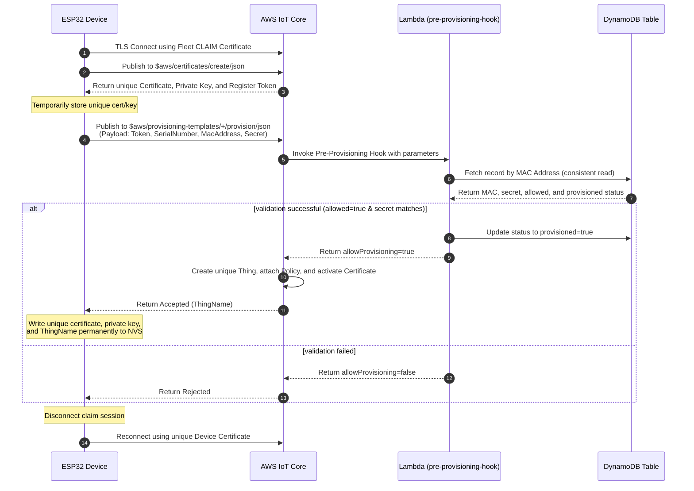
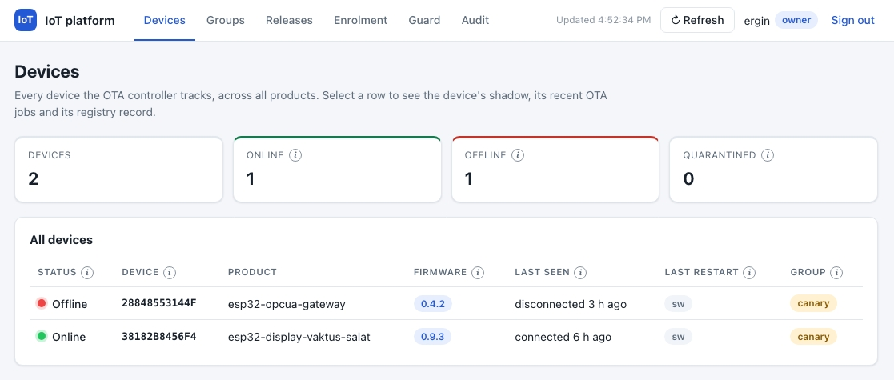
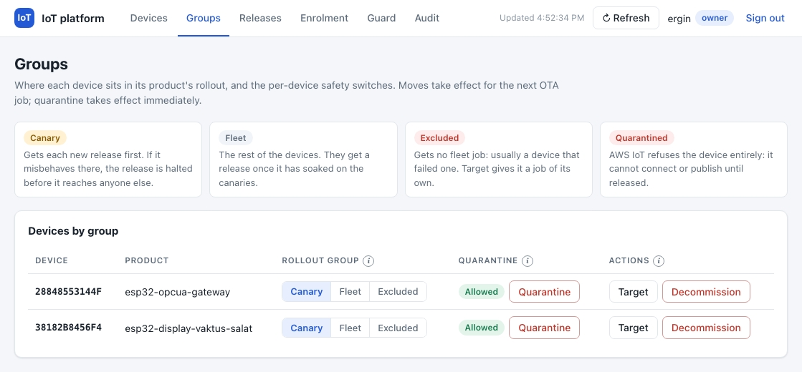
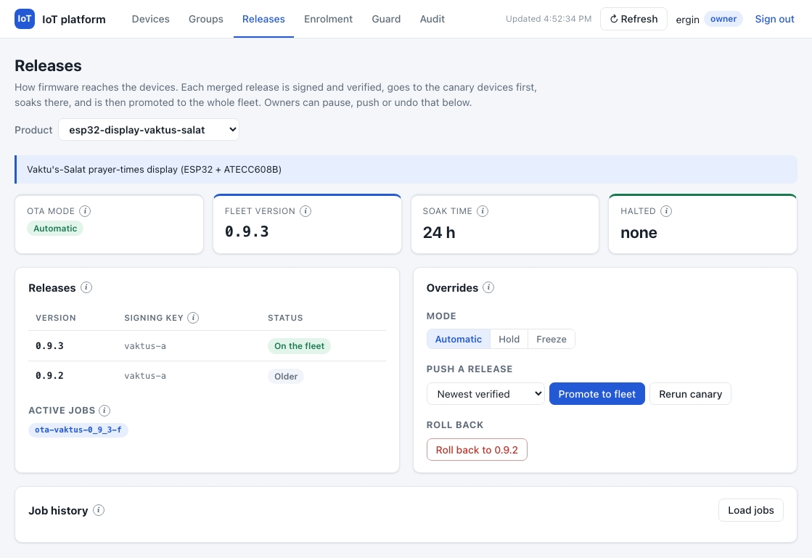

# ESP32 Zero-Touch Provisioning (ZTP) & OTA Platform Infrastructure

This repository contains the Terraform-managed AWS serverless infrastructure that powers **Zero-Touch Fleet Provisioning by Claim (ZTP)** and **Automated, Event-Driven Over-The-Air (OTA) Firmware Updates** for ESP32 devices.

The platform hosts several **products**, listed in the `products` variable ([variables.tf](variables.tf)):

| Product id | Device | Firmware repository | Enrols with |
| :--- | :--- | :--- | :--- |
| `gateway` | OPC UA gateway, Waveshare ESP32-S3-ETH | `ergousha/esp32-opcua-gateway-rust` | the registry secret (key generated by AWS) |
| `vaktus` | Vaktu's-Salât prayer-times display, ESP32 + ATECC608B | `ergousha/esp32-display-vaktus-salat-rust` | its registered public key (key never leaves the ATECC608B) |

Each product has its own fleet and canary thing groups, provisioning template, firmware prefix in the bucket, SSM template parameter and GitHub Actions role. A release of one product can never reach, cancel or overwrite another's.

---

## 1. High-Level Solution Architecture

This diagram shows the relationship between developers, GitHub Actions, AWS infrastructure components, and the ESP32 devices:



---

## 2. Zero-Touch Provisioning (ZTP) Flow

ZTP uses **AWS IoT Fleet Provisioning by Claim**. The device leaves the factory with a **common** "claim" (bootstrap) certificate. Upon first connection, it generates its own **unique** certificate, verifies its identity via a pre-provisioning hook, and receives unique credentials.

### ZTP Sequence Diagram



A device with a secure element (Vaktus) calls `CreateCertificateFromCsr` (`$aws/certificates/create-from-csr/json`) instead of `CreateKeysAndCertificate`: it sends a CSR signed inside its ATECC608B and receives a certificate for that key, so no private key crosses the wire.

### Security Model
*   **Claim certificate is INACTIVE** outside enrolment windows. It is extractable from any firmware image or device, so it only works while you enrol a device: `ergo commission` (or `scripts/claim-window.sh [minutes]`) arms it for a registered device's window, and the OTA controller's tick disarms it once no registry record has an open window (see [Enrolling a Device](#enrolling-a-device)). Provisioned devices use their own certificates and never need it.
*   **Claim Policy**: Allows connecting only as `claim-*` client ids (the firmware uses `claim-<MAC12>`), so a claim holder cannot take over a device's client id. Restricts devices to publish/subscribe *only* on provisioning topics (`$aws/certificates/create/*`, `$aws/certificates/create-from-csr/*` and each product's `$aws/provisioning-templates/<template>/provision/*`). It prevents devices from publishing telemetry or accessing other IoT resources. The claim certificate is shared by all products; what each product may enrol as is decided by the hook.
*   **Device Policy**: Dynamically restricts each provisioned device using policy variables. Devices can only connect if their `ClientId` matches their `ThingName`. They are restricted to publish to `dt/${iot:Connection.Thing.ThingName}/*` and subscribe to `cmd/${iot:Connection.Thing.ThingName}/*`.
*   **Lambda Hook** ([lambda/pre_provisioning_hook](lambda/pre_provisioning_hook/main.go)) fails closed. It rejects the request unless every check passes:
    1. The template is one of the products' templates (from `templateArn`).
    2. The device's MAC (normalised to `AA:BB:CC:DD:EE:FF`, whatever spelling the device sends) is in DynamoDB with `allowed = true`, **not yet `provisioned`**, and, if the record has `enrol_by`, before that time.
    3. The record's `product` is the template's product. A record without `product` was written before products existed and belongs to the legacy product (`gateway`).
    4. **If the record has a `public_key`, or the product sets `require_public_key`** (Vaktus): the certificate being provisioned (`certificatePem`) must carry exactly that key. A leaked claim credential or shared secret is not enough: only the chip holding the registered key can enrol. The secret is not consulted.
    5. **Otherwise** (gateway): the `Secret` parameter must match the record's `secret` (constant-time comparison).
    6. It then marks the record `provisioned` with a conditional write. A record enrols **once**: a second request (a clone using the public gateway secret, or a race) is rejected, and so is a request whose enrolment could not be recorded.

### Device Registry Records

The table is keyed by `mac_address` (`AA:BB:CC:DD:EE:FF`, upper case):

| Attribute | Type | Meaning |
| :--- | :--- | :--- |
| `mac_address` | S | Hash key |
| `product` | S | Product id the device may enrol as. Missing: the legacy product (`gateway`) |
| `allowed` | BOOL | `false` blocks (re-)enrolment |
| `enrol_by` | N | Optional. Unix seconds after which the record no longer enrols |
| `public_key` | S | The device's public key: the 128 hex digits of X‖Y an ATECC608 GenKey returns, the same with a `04` prefix (colons allowed), or a PEM `PUBLIC KEY` block. Required for Vaktus |
| `secret` | S | Shared secret for products without a secure element |
| `provisioned`, `last_provisioned_serial`, `last_certificate_id`, `last_provisioned_via`, `last_provisioned_at` | | Written by the hook on approval. `provisioned = true` blocks any further enrolment |

A Vaktus record:
```sh
aws dynamodb put-item --table-name esp32-ztp-device-registry --item '{
  "mac_address": {"S": "38:18:2B:84:56:F4"},
  "product":     {"S": "vaktus"},
  "allowed":     {"BOOL": true},
  "provisioned": {"BOOL": false},
  "public_key":  {"S": "<128 hex digits the device logs on first boot>"}
}'
```

Write access to this table is effectively the right to enrol a device: keep it to administrators.

### Enrolling a Device

Use `ergo commission` from [iot-device-sdk](https://github.com/ergousha/iot-device-sdk): it registers the device (with `enrol_by`), writes the claim and Wi-Fi over the serial console, arms the claim for the window and disarms it afterwards. If the laptop dies mid-window, the OTA controller's next tick disarms the claim once `enrol_by` has passed. `scripts/claim-window.sh` remains for a manual enrolment of a registered device.

To **re-enrol** a device (a new key, erased NVS), use `ergo commission --reprovision`: writing the record with `provisioned = false` allows one more enrolment. The controller deactivates and detaches the old certificate once the device has connected with the new one.

---

## 3. Firmware Release & OTA Flow

Releases are fully automated. A merge to a product's `main` runs the SDK's reusable [`firmware-release.yml`](https://github.com/ergousha/iot-device-sdk/blob/main/.github/workflows/firmware-release.yml): next semver from the conventional commits, a build with no secrets and no AWS, a signed manifest, a GitHub pre-release and an upload to S3. The **OTA controller** Lambda ([ota_controller.tf](ota_controller.tf), [lambda/ota_controller](lambda/ota_controller)) takes it from there: canary, soak gate, fleet, halts and emails. Nobody clicks anything unless something goes wrong.

### What a release uploads

```
s3://esp32-ztp-firmware-<account>/releases/<product>/<X.Y.Z>/
    app.bin  factory.bin  manifest.json  manifest.sig   (manifest.sig last)
```

`manifest.json` is canonical JSON `{contract, factory_sha256, product, sha256, size, version}` and `manifest.sig` is `base64(DER(ECDSA-P256-SHA256(manifest.json)))`, made with the product's signing key (GitHub Environment `release`). Each product's GitHub OIDC role may write only `releases/<product>/*`, only from Environment `release`, and only inside the SDK workflow ([iam_github_oidc.tf](iam_github_oidc.tf)). Uploads use `If-None-Match: *`: a published release is never overwritten.

The images are public through CloudFront ([cloudfront.tf](cloudfront.tf)): `https://<distribution>/<product>/<X.Y.Z>/app.bin`. Images carry no secrets, so no presigned URLs: the job document holds a stable URL, and a device's Range resume survives reboots.

### The controller

It runs every 15 minutes (the source of truth), on the S3 event of each `manifest.sig` (the same, sooner), and on owner overrides. Per product:

| Step | Rule |
| :--- | :--- |
| Verify | Every version above `fleet_version` is checked against SSM `/iot-platform/products/<product>/signing_keys` (key id → PEM): canonical manifest, a valid signature, the product and version it names equal to its path, `app.bin` of the manifest's size. A refused release is emailed once and never rolled out. |
| Desired | The highest verified version above `fleet_version` that is not `halted_version`. A newer version clears a halt. A version arriving mid-soak cancels the older canary job (not a halt). |
| Canary | A SNAPSHOT job `ota-<p>-<X_Y_Z>-c` on the canary group. No canary online: an online fleet device is moved in (registry `canary=true` first, else the lowest thing name), with an email; nobody online: wait, one email. A canary QUEUED for 2 h is moved back to the fleet and substituted (`-c-rN`). A product with one device goes straight to the fleet job. |
| Halt | A FAILED or REJECTED canary execution sets `halted_version` and cancels the job. Exception: reason `download` gets one rerun (`-c-r1`). |
| Soak gate | Every canary succeeded, is online, and its `platform` shadow, reported after the update, shows the new `fw` with `boot_count_since_update == 1`. A crash `boot_reason` (panic, watchdogs) halts. A reconnect restarts the soak; a non-crash reboot blocks it (one email; `promote` overrides). Soak: `soak_hours` (6 h; vaktus 24 h). |
| Promote | `auto`: a CONTINUOUS fleet job `ota-<p>-<X_Y_Z>-f`, `fleet_version` set, and only then the previous fleet job cancelled. `hold`: one "ready to promote" email. |
| Fleet failures | One failed device while others succeed: moved to the excluded group, email. Two or more: the fleet job is cancelled and the version halted. |
| Done | One "fleet on X.Y.Z" email. |
| Legacy | Jobs of the old `ota_trigger` (`ota-<p>-firmware_v…-<ms>`) are cancelled: their presigned URLs died with it. |

Job documents always carry the v1 fields (`operation`, `product`, `firmware_version`, `download_url`) and `contract: 1`. They also carry `manifest`, `sig` and `key_id` once **every** target device reports that key id in its `platform` shadow: a device whose firmware has no keys yet would refuse a signed job, so it gets the v1 document while the controller has already checked the signature. A `signed-only` mode ends that transition. Executions time out after `ota_in_progress_timeout_minutes` (60) with two retries; a FAILED execution is final.

State lives in the attributes of the product's fleet group: `ota_mode` (`auto`, `hold`, `frozen`), `soak_hours`, `fleet_version`, `halted_version`, `halted_reason`, and `notified` (the one-off emails already sent). Terraform ignores them. Emails go to SNS `esp32-ztp-ota` (confirm its subscription mail once).

### Owner overrides

```sh
scripts/ota.sh status   vaktus
scripts/ota.sh promote  vaktus [X.Y.Z]      # skip the soak gate
scripts/ota.sh hold|resume|freeze vaktus
scripts/ota.sh rerun    vaktus [X.Y.Z]      # canary again, clears that version's halt
scripts/ota.sh rollback vaktus X.Y.Z        # downgrade:true fleet job; then on hold
scripts/ota.sh target   vaktus <thing>      # back from excluded, with its own job
scripts/ota.sh rotate-claim
```

```sh
scripts/ota.sh quarantine|unquarantine vaktus <thing>   # in or out of the deny-all group
scripts/ota.sh decommission vaktus <thing>              # certificates INACTIVE, thing deleted (asks first)
scripts/ota.sh guard-reset                              # guard-reset.sh, plus the configured rules back on
```

Only `rollback` downgrades, and only to a verified version; the tick never does. The same actions go through the controller's `AWS_IAM` Function URL (`terraform output ota_controller_function_url`), which the [portal](#6-portal) uses; a caller on the portal's viewer role gets `status` only. Overrides that create jobs are refused while the guard is tripped. Every email of an action requested through the URL names the caller's role session and access key.

### Thing groups

| Product | Fleet group (state, fleet job) | Canary group (child of fleet) | Excluded group | Template |
| :--- | :--- | :--- | :--- | :--- |
| `gateway` | `esp32-ztp-fleet` | `esp32-ztp-canary` | `esp32-ztp-gateway-excluded` | `esp32-s3-fleet-template` |
| `vaktus` | `esp32-ztp-vaktus-fleet` | `esp32-ztp-vaktus-canary` | `esp32-ztp-vaktus-excluded` | `esp32-ztp-vaktus-fleet-template` |

A thing is in one group of a hierarchy, so canaries and the rest of the fleet are disjoint, and canaries also get the fleet job (they settle it without a download). Canary membership is the controller's: mark a device with `canary=true` in the registry (`ergo commission --canary`) and the next tick moves it in. The fleet kill switch cuts off fleet and excluded groups alike.

### Presence

A rule writes every connect and disconnect lifecycle event into `esp32-ztp-device-presence` ([presence.tf](presence.tf)), one item per thing and event type. The controller reads it for the canary choice and the soak gate, and to tell which certificate a re-enrolled device now uses.

### The claim

The claim certificate is no longer in Terraform. The controller:

* keeps it ACTIVE only while a registry record has an open window (`allowed`, not `provisioned`, `enrol_by` in the future) and the guard is clear. `ergo commission` arms and disarms bench windows itself; site windows (`ergo register --minutes`, up to a week) are armed by the tick;
* rotates it after a site window, when asked (`scripts/ota.sh rotate-claim`), and whenever SSM and the claim policy disagree: a P-256 key generated in memory, `CreateCertificateFromCsr`, the claim policy attached, `/iot-platform/claim/{cert,key}` (SecureString) written, the old certificate deactivated and deleted;
* hourly, deletes certificates attached to no thing for over a day, and deactivates the older certificate of a re-enrolled thing once presence shows it connecting with the new one;
* hourly, emails about a GitHub pre-release over an hour old whose manifest never reached S3.

---

## 4. Setup & Deployment Guide

### Prerequisites
*   Terraform `>= 1.10` (the S3 backend uses `use_lockfile`; CI pins 1.17.1)
*   AWS CLI `v2`
*   Go `>= 1.22` (required to compile Go Lambda binaries during Terraform runs)

### AWS Authentication Configuration
No long-lived admin credentials exist. The one IAM user's access key lives in the macOS keychain ([aws-vault](https://github.com/99designs/aws-vault)), and on its own it can only read the firmware build parameters in SSM and assume an admin role, which requires MFA:

```ini
# ~/.aws/config
[profile ergin]
region = eu-central-1

[profile ergousha-admin]
source_profile = ergin
role_arn       = arn:aws:iam::<account>:role/owner-admin
mfa_serial     = arn:aws:iam::<account>:mfa/<device>
duration_seconds = 43200
region = eu-central-1
```

```sh
aws-vault add ergin                                     # once: stores the key in the keychain
aws-vault exec ergousha-admin -- terraform apply        # asks for the MFA code, 12-hour session
aws-vault exec ergousha-admin -- scripts/ota.sh status vaktus
```

### Terraform Deployment
1.  Initialize remote backend and providers:
    ```sh
    terraform init
    ```
2.  Inspect proposed changes:
    ```sh
    terraform plan
    ```
3.  Deploy:
    ```sh
    terraform apply
    ```

### Local Development & VS Code Tasks
To simplify developer workflows, this repository is configured with VS Code Tasks (defined in `.vscode/tasks.json`). You can execute them by opening the Command Palette (`Cmd+Shift+P` / `Ctrl+Shift+P`), typing `Tasks: Run Task`, and selecting one of the following:

*   **Go: Build Lambdas**: Compiles both Go Lambda functions for Linux/AMD64.
*   **Go: Run Unit Tests**: Runs all unit tests with verbose logging (`go test -v ./...`).
*   **Go: Format Code**: Formats Go code styling (`gofmt -s -w .`).
*   **Go: Lint Code**: Audits Go code quality using `golangci-lint`.
*   **Go: Clean Binaries**: Cleans up local builds and temporary ZIP archives.
*   **Terraform: Format Files**: Rewrites Terraform files into canonical format (`terraform fmt`).
*   **Terraform: Validate**: Initializes modules and validates Terraform structure (`terraform init -backend=false && terraform validate`).
*   **Terraform: Lint (TFLint)**: Audits Terraform configurations using `tflint`.
*   **Portal: Install Dependencies**: `npm ci --ignore-scripts` (the lockfile only; no dependency runs code at install time).
*   **Portal: Format Code**: Formats and organises imports with Biome (`npm run format`).
*   **Portal: Lint & Typecheck**: Biome lint and format check (warnings fail) and `tsc`.
*   **Portal: Run Unit Tests** / **Portal: Build**: Vitest; the production build into `portal/dist`.
*   **Security: Audit Workflows (zizmor)**: `zizmor` and `actionlint` over `.github/`.
*   **Security: Audit Dependencies**: `govulncheck` for the Lambdas; `npm audit` and `npm audit signatures` for the portal.

Local tools beyond Go, Terraform and Node: `tflint` at the CI version (`go install github.com/terraform-linters/tflint@v0.64.0`; Homebrew no longer ships it), `golangci-lint`, and `brew install zizmor actionlint`.

CI runs the same checks: [`ci.yml`](.github/workflows/ci.yml) (Go, Terraform with TFLint, the portal), [`zizmor.yml`](.github/workflows/zizmor.yml) on workflow changes, and [`security-audit.yml`](.github/workflows/security-audit.yml) on dependency changes and weekly. Dependabot ([`dependabot.yml`](.github/dependabot.yml)) proposes Go, npm, Terraform provider and action updates only once a release is 14 days old.

### SSM Parameter Store Integration

| Parameter | Written by | Read by |
| :--- | :--- | :--- |
| `/esp32-ztp/poc/iot_endpoint`, `/esp32-ztp/poc/<product>/provisioning_template_name` | Terraform | anyone (public facts; builds compile them from `platform.toml` now) |
| `/esp32-ztp/guard/state` | the kill switch, `guard-reset.sh` | the controller, `ergo`, `claim-window.sh` |
| `/iot-platform/products/<product>/signing_keys` (JSON: key id → public key PEM) | the owner, when creating or rotating signing keys (no Terraform) | the controller |
| `/iot-platform/claim/{cert,key}` (SecureString), `/iot-platform/claim/state` | the controller | `ergo commission` only |

### Secure GitHub Actions OIDC Trust
This infrastructure uses AWS IAM Identity Federation via OpenID Connect (OIDC) to grant secure access to GitHub Actions runners without requiring long-lived AWS secrets to be saved in GitHub.

Each product has its own role ([iam_github_oidc.tf](iam_github_oidc.tf)), trusted only by its repository's Environment `release` (`sub = repo:<owner>@<id>/<repo>@<id>:environment:release`) and only inside the SDK's reusable release workflow (`job_workflow_ref`). It may put and get `releases/<product>/*`, nothing else: no SSM, no IoT.

| Product | Role (the repository's `AWS_ROLE_ARN` variable) | May write |
| :--- | :--- | :--- |
| `gateway` | `esp32-ztp-github-actions-role` | `releases/gateway/*` |
| `vaktus` | `esp32-ztp-vaktus-github-actions-role` | `releases/vaktus/*` |

`terraform output github_actions_role_arns` lists them. To add a product, add an entry to the `products` variable in [variables.tf](variables.tf) (its repository's numeric id: `gh api repos/<owner>/<repo> --jq .id`) and apply.

---

## 5. Guard Rails (Cost Protection)

Denial-of-wallet is the main threat to a self-funded platform. [guard.tf](guard.tf) wires free CloudWatch alarms and two budgets to the SNS topic `esp32-ztp-guard`. The topic emails `alert_email` (required: set it in `terraform.tfvars`, then click the link in AWS's confirmation mail) and invokes the kill switch ([lambda/kill_switch](lambda/kill_switch/main.go)).

| Alarm / budget | Trips when | Scope |
| :--- | :--- | :--- |
| `esp32-ztp-guard-publish-5m` | IoT publishes (MQTT + HTTPS) > `guard_publish_per_5min` (1,000) in 5 min | traffic |
| `esp32-ztp-guard-publish-30m` | the same for 30 min in a row | fleet |
| `esp32-ztp-guard-connect-5m` | IoT connects > `guard_connect_per_5min` (30) in 5 min | provisioning |
| `esp32-ztp-guard-hook-5m` | hook invocations > `guard_hook_per_5min` (10) in 5 min | provisioning |
| `esp32-ztp-guard-ota-errors`, `-kill-switch-errors` | a Lambda failed | email only |
| budget `esp32-ztp-guard-traffic` | actual cost > $10 this month, again at $15 (email at $5 actual and $10 forecast) | traffic |
| budget `esp32-ztp-guard-fleet` | actual cost > $25 this month, again at $37.50 | fleet |

The measured baseline was at most 48 publishes and 4 connects per 5 minutes. Each scope includes the ones above it:

* **provisioning**: the claim certificate (every target of the claim policy) goes INACTIVE.
* **traffic**: the telemetry → CloudWatch Logs rules and the presence rule are disabled (while it lasts, the soak gate sees no reconnects).
* **fleet**: the deny-all policy `esp32-ztp-guard-deny-all` is attached to every fleet and excluded group. Every device is refused on its next publish or connect, so the fleet goes offline and messaging cost stops.

Every trip is recorded in the SSM parameter `/esp32-ztp/guard/state`. `claim-window.sh` refuses to open a window while it is tripped. Once you know why it tripped:

```sh
aws ssm get-parameter --name /esp32-ztp/guard/state --query Parameter.Value --output text
scripts/guard-reset.sh      # detaches deny-all from the fleet groups, clears the state
terraform apply             # restores the rules to their configured value
```

To cut off a **single** device, add it to the quarantine group, which carries the deny-all policy permanently (Device Defender, which could do this automatically, is no longer offered to new customers):

```sh
aws iot add-thing-to-thing-group --thing-name <thing> --thing-group-name esp32-ztp-quarantine
```

To test the wiring, set the hook alarm by hand (provisioning scope: it only re-asserts the INACTIVE claim). The alarm returns to its real state at the next evaluation, but the kill switch records a **real trip**, so finish with a reset:

```sh
aws cloudwatch set-alarm-state --alarm-name esp32-ztp-guard-hook-5m --state-value ALARM --state-reason test
scripts/guard-reset.sh --yes
```

Do not test with the publish alarms unless you mean it: `publish-30m` cuts off the whole fleet.

Budget notifications lag the spend by hours, so the alarms are the first line and the budgets the backstop. An ACTUAL budget alert fires once per month, so each budget alerts the kill switch again at 150 % (`guard-reset.sh` warns when a budget is already over its limit). The publish alarms count messages, not bytes: AWS bills per 5 KB, so a flood of large messages just under the threshold is bounded only by the budgets. AWS Cost Anomaly Detection (its default services monitor, daily email) is on as well. The Lambda account concurrency limit stays at its default of 10: at most 10 Lambda invocations run at once, whatever triggers them, which caps Lambda cost for free.

---

## 6. Portal

A web console for the platform: see every device, release and alarm, and make the owner's changes (rollout groups, OTA overrides, quarantine, guard reset) without the CLI. It is a static SPA ([portal/](portal), Vite + React + TypeScript) on its own CloudFront origin ([portal.tf](portal.tf)). It is not on `ergousha.github.io`: every Pages site of the account shares that origin and could read the portal's tokens.

Each screen opens with a sentence on what it is for, and the ⓘ marks and status labels explain themselves on hover. Two roles see it: an **owner** gets the buttons, a **viewer** the same screens read-only. Nothing refreshes on its own; **↻ Refresh** reloads everything from AWS.

### Devices



Every device the OTA controller tracks, across products. The headline cards count devices that are online, offline and quarantined. Each row has a green or red light (online is derived from the connect and disconnect events, see [Presence](#presence)), the reported firmware, when the device last connected or disconnected (hover for the exact times), why it last restarted (`sw` is a software restart, for example after an OTA update; crashes and watchdog resets show in red) and its rollout group. Selecting a row opens the device: its product shadow, its OTA job executions, its registry record and what it reports to the controller. An owner can set desired state on the product shadow (`vaktus`, `opcua`) from there.

### Groups



Where each device sits in its product's rollout ([Thing groups](#thing-groups)), and the per-device safety switches. The legend explains the four states. Per device, the owner:

- switches between **Canary**, **Fleet** and **Excluded** (straight to AWS IoT, within the device's own product groups);
- **Quarantines** it: AWS IoT refuses the device's next connect or publish until it is released;
- **Targets** it: a job of its own for the fleet version, which also brings an excluded device back;
- **Decommissions** it: its certificates go inactive and the thing is deleted, after typing the thing name to confirm.

Everything except the group switch goes through the OTA controller, which emails the change with the requesting session.

### Releases



How firmware reaches one product's devices; the picker at the top chooses the product. The cards show the [OTA mode](#owner-overrides), the fleet version, the soak time and whether a release is halted. The releases table places every verified release against the fleet (**On the fleet**, **Newer**, **Older**, **Halted**, or **Refused** with the controller's reason) with the key that signed it, and lists the product's active OTA jobs. The owner's [overrides](#owner-overrides):

- **Mode**: Automatic (canary, soak, promote), Hold (canary and soak, then an email instead of promoting) or Freeze (the controller leaves the product alone);
- **Promote to fleet** (skips the soak) and **Rerun canary**, for the newest or a chosen verified release;
- **Roll back** to a verified version below the fleet's (the current one is halted and the product goes on hold).

**Job history** loads the product's OTA jobs on demand.

### Other screens

| Screen | Shows | Owner can |
| :--- | :--- | :--- |
| Enrolment | how a device joins: open enrolment windows, the claim certificate (active only while a window is open, when it was last rotated) and the registry with each record's state in plain words. Read-only: windows are opened with `ergo commission` | |
| Guard | what the [guard](#5-guard-rails-cost-protection) is, whether it is clear or tripped (and why), the three stages a trip goes through, every guard alarm with its state, and the quarantined devices | reset the guard |
| Audit (owner only) | portal sign-ins (CloudTrail, by the `username` session tag) and the AWS calls each session made | |

### Sign-in, security and deployment

**Sign-in.** Cognito managed login (Essentials tier: free up to 10,000 monthly active users), styled like the portal in light and dark mode (colours and logos in [portal.tf](portal.tf), logo source in `portal/branding/`, rendered by `scripts/portal-branding.sh`), admin-created users only, TOTP required, no SMS. Code flow with PKCE; tokens in memory only, so a reload signs in again through managed login's session cookie. An identity pool maps the user's group to an IAM role: `owner` or `viewer`; a user in neither gets no credentials. No browser role can touch certificates, the claim, templates, the registry or jobs; everything beyond shadow desired state and canary/excluded membership goes through the controller's Function URL, whose CORS admits only the portal origin. `lambda:InvokeFunction` is granted only with `lambda:InvokedViaFunctionUrl`, so a viewer cannot bypass the URL's role check with a direct invoke.

**Headers** (a viewer-response CloudFront Function; the Free plan allows no custom response headers policy): `default-src 'none'; script-src 'self'; style-src 'self'; connect-src` the AWS endpoints only; `frame-ancestors 'none'`, `X-Frame-Options: DENY`, HSTS, `no-referrer`, a Permissions-Policy that denies camera, microphone, USB, serial and the rest. Device-written fields are rendered as clipped React text only. Nothing polls: data loads at sign-in and on **Refresh**.

**Deploy.**

```sh
terraform apply                                 # Cognito, roles, bucket, distribution, config.json
scripts/portal-deploy.sh                        # npm ci --ignore-scripts, test, build, upload
scripts/portal-user.sh add <name> <email> owner # Cognito emails a temporary password
terraform output portal_url
```

Then put the portal distribution on the CloudFront **Free flat-rate plan** in the console, as for the firmware distribution. `scripts/portal-user.sh role <name> viewer|owner|none` changes a role and ends the user's sessions; `remove` deletes a user.

**Checks after the first deploy**:

1. Every override works from the portal: hold, resume, freeze, promote, rerun, rollback, target, quarantine, decommission, guard reset.
2. Framing is blocked: an `<iframe src="<portal_url>">` on any other page stays blank (`frame-ancestors 'none'`, `X-Frame-Options: DENY`).
3. The viewer role cannot write: as a viewer, the controller answers 403 to anything but `status`, and `aws lambda invoke` with the viewer's credentials is denied.
4. Shadow reads and desired-state writes work with the identity pool's credentials. AWS documents HTTPS SigV4 calls as IAM-only (an IoT policy on the Cognito identity is for MQTT); if that is wrong, these two calls move behind the Function URL.

## 7. Project Costs & Teardown

### Cost Breakdown
All resources deployed in this repository are serverless and billed purely on-demand, costing **~$0.00 USD/month when idle**:

| Service | Billing Model | PoC Cost |
| :--- | :--- | :--- |
| **IoT Core** | per connectivity-minute & message | Negligible for PoC connections |
| **DynamoDB** | PAY_PER_REQUEST (On-Demand), capped at 2 reads and 2 writes per second; PITR on | Billed per request (a few a month); PITR about $0.000001 a month |
| **AWS Lambda** | per invocation & duration | Billed per millisecond; free tier covers PoC |
| **Amazon S3** | per GB-month & requests | Storage cost for binaries is fractions of a cent |
| **CloudWatch Logs** | per GB ingested/stored | Kept low via a 3-day retention period; telemetry routing off by default |
| **CloudFront** (firmware) | Free flat-rate plan | $0, no overage (attach the plan in the console after the first apply; see [cloudfront.tf](cloudfront.tf)) |
| **EventBridge Scheduler** | 2,976 ticks a month | $0 (14M free invocations) |
| **CloudWatch alarms, SNS, Budgets** | per alarm metric, message, action | $0: 8 of the 10 free alarm metrics, a handful of messages, budgets without actions |
| **Portal**: Cognito Essentials, identity pool, CloudFront (Free plan), S3 | per MAU (Essentials: free up to 10,000) | $0 |

Telemetry is not routed to CloudWatch Logs by default (`debug_telemetry_logs = false`): every message would be billed as a rule, an action and Logs ingestion. Turn it on for a debugging session or a gateway HIL run (`terraform apply -var debug_telemetry_logs=true`), and off again afterwards.

### Teardown
To destroy all Terraform-managed resources:
```sh
terraform destroy
```

The portal's user pool has deletion protection: set `deletion_protection = "INACTIVE"` in [portal.tf](portal.tf) and apply first. Empty the portal bucket (`aws s3 rm s3://<portal bucket> --recursive`) as well.
